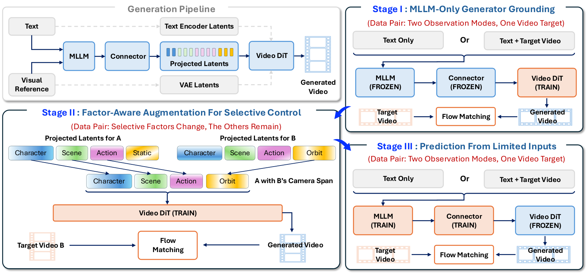
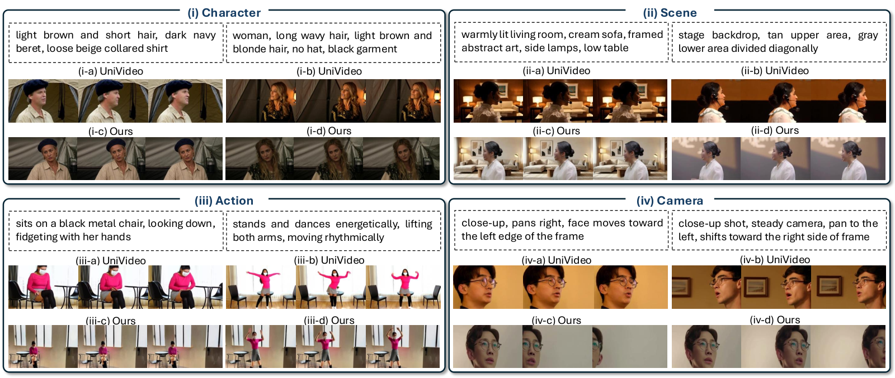

# Making MLLM Latents Matter: Factor-Aware Predictive Learning for Cinematic Video Generation


<p align="center">
  <a href="https://arxiv.org/abs/2610.30926"></a>
  <a href="https://arxiv.org/html/2610.30926"></a>
  <a href="https://shotverse.github.io/fapl/"></a>
  <a href="[https://github.com/<org>/FAPL](https://github.com/Songlin1998/ShotVerse2.0)"></a>
  <a href="LICENSE"></a>
</p>

<p align="center">
  <strong>Songlin Yang<sup>1,*,†</sup> &nbsp; Zhe Wang<sup>1,*</sup> &nbsp; Xiaotong Zhao<sup>2</sup> &nbsp; Xi Wang<sup>3</sup> &nbsp; Ran Zhang<sup>2</sup> &nbsp; Shuai Li<sup>2</sup><br>
  Taiyi Wu<sup>2</sup> &nbsp; Songlian Li<sup>2</sup> &nbsp; Eric Liu<sup>2</sup> &nbsp; Alan Zhao<sup>2</sup> &nbsp; Anyi Rao<sup>1</sup></strong>
</p>

<p align="center">
  <sup>1</sup>MMLab@HKUST, The Hong Kong University of Science and Technology &nbsp;·&nbsp;
  <sup>2</sup>Tencent Video &nbsp;·&nbsp;
  <sup>3</sup>LIX, École Polytechnique
</p>

<p align="center"><sup>*</sup>Equal contribution &nbsp;·&nbsp; <sup>†</sup>Project lead</p>

---

## TL;DR

**FAPL** (Factor-Aware Predictive Learning) makes MLLM representations *actually usable* by a Video DiT for cinematic video generation. It targets two capabilities — **temporal inference from limited inputs** and **factor-aware control** of character / scene / action / camera — with three training stages and **no architectural changes**:

1. **Stage I — MLLM-Only Generator Grounding**: freeze MLLM + connector, train the DiT with MLLM latents as the *sole* content condition.
2. **Stage II — Factor-Aware Control Improvement**: factor-span replacement between paired edits supervises *what should change* and *what should be preserved*.
3. **Stage III — Prediction From Limited Inputs**: freeze the trained DiT, optimize MLLM + connector through it, with text-only and text-plus-complete-video observations sharing one video target.

Built on **UniVideo (13B DiT)**, FAPL improves Motion Order from 48% → **61%**, ∩-Acc from 42% → **58%**, and FaceSim-Arc from 0.451 → **0.523**.

---

## News

- **2026-10-22**: arXiv preprint released. [[arXiv](https://arxiv.org/abs/2610.30926)] [[HTML](https://arxiv.org/html/2610.30926)]
- **TODO**: code, checkpoints, and `CineFactor-10K` evaluation prompts release.

---

## Method

[](assets/fapl-method.png)

*FAPL framework (Figure 3 in the [paper](https://arxiv.org/html/2610.30926v1#S3.F3)).*

FAPL trains MLLM representations for video generation from limited inputs and control over character, scene, action, and camera. The original connector maps MLLM hidden states into the Video DiT's conditioning space. To make the generator use these representations, all three training stages use MLLM latents as the only content condition. FAPL retains the original architecture and uses flow matching throughout training.

### Stage I: MLLM-Only Generator Grounding

With the MLLM and connector frozen, we train the DiT to use their projected latents. Each training video has two observation modes: its text description alone, or the description together with the complete video. Both modes share the same video target. The complete-video mode grounds the generator in visual and temporal evidence; the text-only mode prepares it for generation from limited inputs. Separate text-encoder and VAE-reference conditions are disabled during training.

### Stage II: Factor-Aware Control Improvement

The MLLM and connector remain frozen while the DiT learns from text-only descriptions of video pairs that differ in one factor. Structured prompts identify character, scene, action, and camera spans. We swap the selected span between the two projected sequences, after the connector and before the DiT, leaving other spans unchanged. Training uses both replacement directions with the corresponding paired video as the target.

For example, replacing a static-camera span with an orbit-camera span is supervised by the paired orbit-camera video. These paired targets teach the generator both the requested change and preservation of other factors.

### Stage III: Prediction From Limited Inputs

We then freeze the trained DiT and jointly update the MLLM and connector. The same two observation modes still share one target video, and gradients pass through the frozen DiT to the MLLM pathway. Text-only inputs train the MLLM to infer semantic, motion, and temporal content that the generator can decode. Complete-video inputs provide complementary reconstruction supervision through the same interface, linking prediction from limited evidence to the target video.

### Inference

At inference, a script and optional character or scene references pass through the MLLM and connector to condition video generation. No complete target video is required. To edit one factor, we re-encode the modified prompt and replace only its corresponding latent span. For multi-shot generation, shots are generated independently, sharing character and scene references while allowing action and camera instructions to vary.

See [Section 3 of the paper](https://arxiv.org/html/2610.30926v1#S3) for the full formulation and training algorithm.

---

## Results

Selected results from [Table 1](https://arxiv.org/html/2610.30926v1#S4.T1), comparing FAPL with its UniVideo (13B) backbone. Higher is better for all three metrics.

| Task | Metric | UniVideo | FAPL |
| --- | --- | ---: | ---: |
| Sparse-to-Video | Motion Order (%) | 48 | **61** |
| Factor-Aware Editing | ∩-Acc (%) | 42 | **58** |
| Multi-Shot | FaceSim-Arc | 0.451 | **0.523** |

Sparse-to-video and editing each use 5K CineFactor-10K cases; multi-shot evaluation uses 100 ShotVerse-Bench sequences.

[](assets/fapl-factor-editing.png)

*Factor-aware editing examples from [Figure 5](https://arxiv.org/html/2610.30926v1#S4.F5). Each panel changes one prompt field, with UniVideo outputs above FAPL outputs. The comparison shows the requested edit and its effect on the remaining content.*

See the [paper](https://arxiv.org/html/2610.30926v1#S4) for the full comparisons and ablations, and the [project page](https://shotverse.github.io/fapl/) for video demos.

---

## TODO

- [ ] Release training and inference code
- [ ] Release `CineFactor-10K` evaluation prompts
- [ ] Release Stage I–III checkpoints
- [ ] Release project page with video demos

## Citation

```bibtex
@misc{yang2026makingmllmlatentsmatter,
      title={Making MLLM Latents Matter: Factor-Aware Predictive Learning for Cinematic Video Generation}, 
      author={Songlin Yang and Zhe Wang and Xiaotong Zhao and Xi Wang and Ran Zhang and Shuai Li and Taiyi Wu and Songlian Li and Eric Liu and Alan Zhao and Anyi Rao},
      year={2026},
      eprint={2610.30926},
      archivePrefix={arXiv},
      primaryClass={cs.CV},
      url={https://arxiv.org/abs/2610.30926},}
```

## Acknowledgements

We build upon [UniVideo](https://github.com/) and compare with [Omni-Video 2](https://arxiv.org/abs/2602.08820). Our training and evaluation data draw on [CoinVE-200K](https://arxiv.org/abs/2608.17566) and [OmniVBench](https://arxiv.org/abs/2609.22069); multi-shot evaluation uses [ShotVerse-Bench](https://arxiv.org/abs/2603.11421). Metrics follow [VBench-2.0](https://arxiv.org/abs/2503.21755), [FiVE](https://arxiv.org/abs/2503.13684), and [π³](https://arxiv.org/abs/2507.13347).

## License

This project is released under the [MIT License](LICENSE). Model checkpoints and dataset usage may be subject to the licenses of the underlying backbones and data sources.
